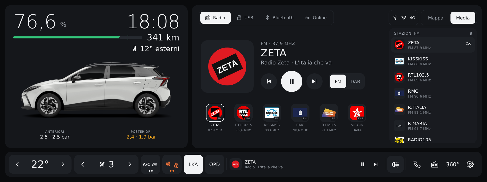
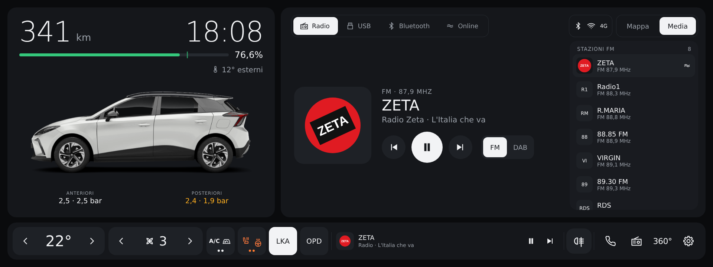
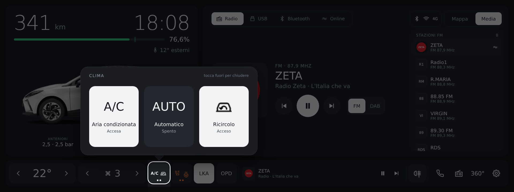
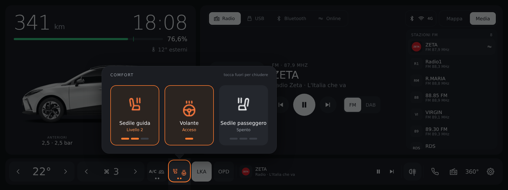
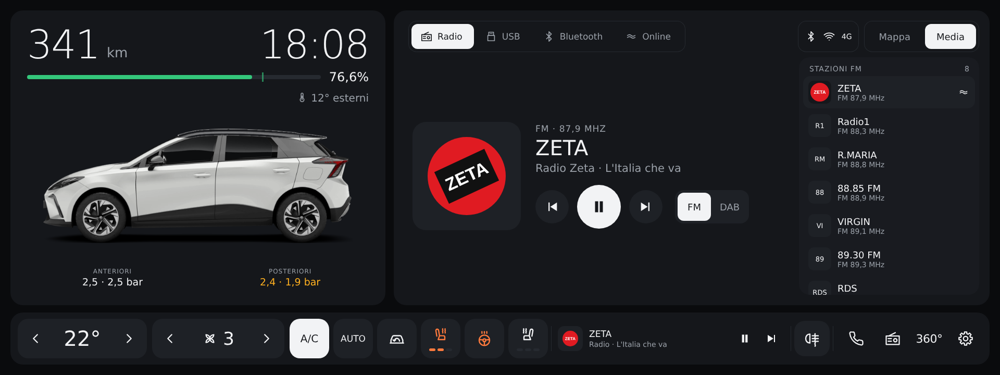
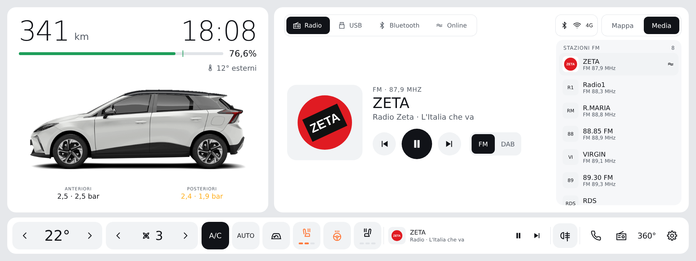
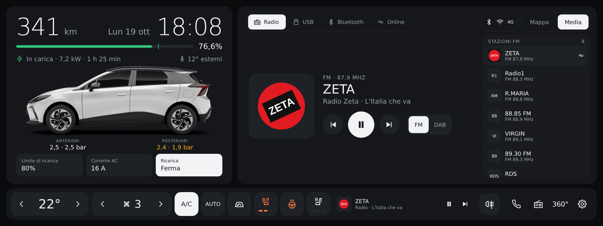
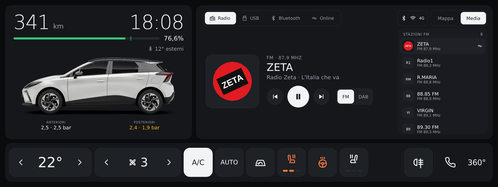
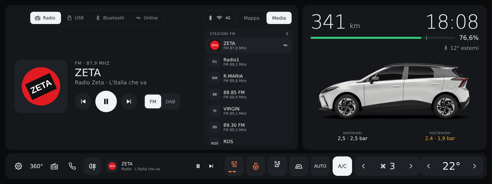
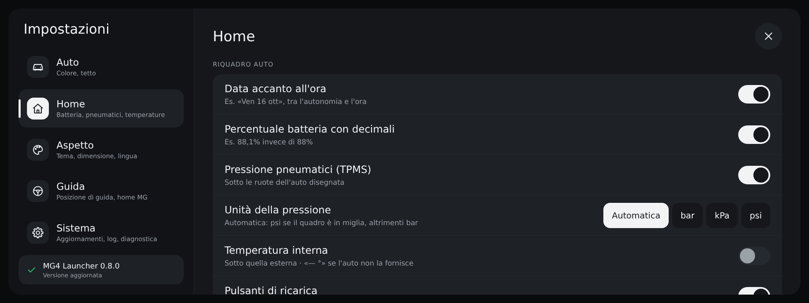

# MG4 Launcher — SWI68 SAIC 1.0+

🇮🇹 [Italiano](#italiano) · 🇬🇧 [English](#english)

**Ultima versione / Latest version: [0.9](releases/MG4Launcher-0.9.apk)**

[](https://www.paypal.com/pool/9tv7fQ36nA?sr=wccr) [](https://www.paypal.com/pool/9tv7fQ36nA?sr=wccr)

> ⚠️ **Compatibilità / Compatibility:** solo infotainment **SWI68 SAIC 1.0+** · only **SWI68 SAIC 1.0+** infotainment.
> Provato su **MG4 Luxury MY22 R69**; dovrebbe funzionare su tutte le versioni con radio SAIC 1.0+ ·
> tested on **MG4 Luxury MY22 R69**; it should work on every version with the SAIC 1.0+ radio.
> Per gli altri software usa la versione dedicata · for the other software use the dedicated version:
> **SWI69 Color Radio** → [Mg4-Launcher-SWI69](https://github.com/ernestomicco2026-cell/Mg4-Launcher-SWI69) · **SWI132 (MG4 MY24)** → [Mg4-Launcher-SWI132](https://github.com/ernestomicco2026-cell/Mg4-Launcher-SWI132) ·
> **SWI133 (MG4 Luxury MY24)** → [Mg4-Launcher-SWI133](https://github.com/ernestomicco2026-cell/Mg4-Launcher-SWI133).

> Progetto amatoriale e **non ufficiale**: non è affiliato né approvato da MG Motor o SAIC Motor.
> I nomi MG / MG4 servono solo a indicare l'auto compatibile (infotainment SWI68). Installalo e usalo a tuo rischio.
>
> Hobby project, **not official**: not affiliated with or endorsed by MG Motor or SAIC Motor.
> The MG / MG4 names only identify the compatible car (SWI68 infotainment). Install and use it at your own risk.

---

*Home 0.9: percentuale della batteria e temperatura più grandi · 0.9 home: bigger battery percentage and temperature (mock-up).*


*Opzione "Percentuale batteria in grande": km e percentuale invertiti · "Large battery percentage" option: km and percentage swapped (mock-up).*


*Home 0.8.3: lista stazioni e preferiti con logo, nome e frequenza · 0.8.3 home: station list and favourites with logo, name and frequency (mock-up).*


*Home 0.8.2: barra con i gruppi Clima e Comfort, LKA e OPD, mini player · 0.8.2 home: bar with the Climate and Comfort groups, LKA and OPD, mini player (mock-up).*


*Gruppo Clima aperto: A/C, AUTO, ricircolo · Climate group open: A/C, AUTO, recirculation (mock-up).*


*Gruppo Comfort aperto: sedili a 3 livelli e volante · Comfort group open: 3-level seats and steering wheel (mock-up).*


*Home 0.8.0, notte, guida a sinistra · 0.8.0 home, night, left-hand drive (mock-up).*


*Tema giorno · Day theme (mock-up).*


*Pulsanti di ricarica (limite, corrente AC, avvia/ferma) e data accanto all'ora, durante una ricarica · Charging buttons (limit, AC current, start/stop) and date next to the time, while charging (mock-up).*


*Barra grande · Large bar (mock-up).*


*Guida a destra: home specchiata, auto e clima dal lato del guidatore · Right-hand drive: mirrored home, car and climate on the driver's side (mock-up).*


*Impostazioni 0.8.0, sezione Home, con le nuove opzioni · 0.8.0 settings, Home section, with the new options (mock-up).*


*Impostazioni 0.7.1, sezione Auto (notte) · 0.7.1 settings, Car section (night, mock-up).*


*Impostazioni 0.7.4, sezione Sistema (giorno), con home predefinita e modalità officina · 0.7.4 settings, System section (day), with default home and service mode (mock-up).*


*Pagina App 0.7.4, con Impostazioni Android e File Android · 0.7.4 Apps page, with Android settings and Android files (mock-up).*

---

## Video recensione / Video review

<a href="https://youtu.be/JKZ0N3Lr7FI"></a>

Guarda la [video recensione su YouTube](https://youtu.be/JKZ0N3Lr7FI) · Watch the [video review on YouTube](https://youtu.be/JKZ0N3Lr7FI).

---

## Quale versione installare? / Which version should I install?

Ci sono **quattro launcher diversi**, uno per ciascun software dell'infotainment MG4. Non sono intercambiabili:
servizi dell'auto, radio, media e clima sono diversi. Se installi la versione sbagliata, il launcher lo riconosce,
mostra un avviso con il link alla versione giusta e non tenta nessun collegamento all'auto.

| Software dell'auto | Auto | Repository | File APK |
|---|---|---|---|
| **SWI68 SAIC 1.0+** | MG4 | **questo repository** | `MG4Launcher-X.Y.Z.apk` |
| **SWI69 Color Radio** | MG4 MY23 | [Mg4-Launcher-SWI69](https://github.com/ernestomicco2026-cell/Mg4-Launcher-SWI69) | `MG4Launcher-SWI69-X.Y.Z.apk` |
| **SWI132** | MG4 MY24 | [Mg4-Launcher-SWI132](https://github.com/ernestomicco2026-cell/Mg4-Launcher-SWI132) | `MG4Launcher-SWI132-X.Y.Z.apk` |
| **SWI133** | MG4 Luxury MY24 | [Mg4-Launcher-SWI133](https://github.com/ernestomicco2026-cell/Mg4-Launcher-SWI133) | `MG4Launcher-SWI133-X.Y.Z.apk` |

**Come sapere quale software hai:** con il computer collegato all'auto
`adb shell getprop ro.build.mt2712.version` → l'inizio dice il software: `SWI68-…`, `SWI69-…`, `SWI132-…` o `SWI133-…`.
Se il launcher è già installato: impostazioni → riga **MG4 Launcher X.Y.Z · repository** sotto *Aggiornamenti*;
il nome del repository dice quale versione hai.

There are **four different launchers**, one per MG4 infotainment software, and they are not interchangeable. If you
install the wrong one, the launcher recognises it, shows a notice with a link to the right version and does not try to
connect to the car. Check your software with `adb shell getprop ro.build.mt2712.version` (it starts with `SWI68-`, `SWI69-`, `SWI132-` or
`SWI133-`) and use the matching repository above.

---

## Italiano

Launcher in stile Tesla per l'infotainment della **MG4** con software **SWI68 SAIC 1.0+** (EH32, Android Automotive 9).

**Compatibilità:** funziona **solo con il software SWI68 SAIC 1.0 e successivi**. Con altri software dell'infotainment
i servizi dell'auto possono essere diversi e il launcher potrebbe non funzionare (o funzionare solo in parte): non installarlo.
Al momento il funzionamento è garantito sulla **MG4 Luxury MY22 R69**. Il launcher usa però gli stessi servizi e dati
dell'infotainment originale (FICM), quindi dovrebbe funzionare su tutte le versioni con la radio **SAIC 1.0+**.
Per gli altri software ci sono launcher dedicati: **SWI69 Color Radio** → [Mg4-Launcher-SWI69](https://github.com/ernestomicco2026-cell/Mg4-Launcher-SWI69), **SWI132** (MG4 MY24) → [Mg4-Launcher-SWI132](https://github.com/ernestomicco2026-cell/Mg4-Launcher-SWI132), **SWI133** (MG4 Luxury MY24) → [Mg4-Launcher-SWI133](https://github.com/ernestomicco2026-cell/Mg4-Launcher-SWI133).
Sostituisce la schermata home originale mantenendone le funzioni, con una grafica nuova e pulita.

### Cosa fa

- **Auto e batteria** (a sinistra): autonomia e **orologio** in grande, barra batteria con percentuale e tacca del limite di ricarica,
  **data** (facoltativa), stato solo durante ricarica o V2L (tipo, potenza, tempo rimanente), temperatura esterna e interna; sotto l'auto la **pressione degli pneumatici** (TPMS, in bar, kPa o psi) e, se li attivi, i **pulsanti di ricarica**: limite di ricarica, corrente AC e avvia/ferma ricarica o V2L (con conferma). La tua MG4 ricolorabile con gli 8 colori della gamma, tetto nero opzionale.
  Tocca l'auto → Gestione energia. Tienila premuta → impostazioni del launcher.
- **Mappa / Media / CarPlay** (a destra):
  - **Mappa**: indicazioni del navigatore (prossima manovra, via, arrivo). Senza guida: **Dove andiamo?** con la barra
    *Cerca una destinazione*, i riquadri **Casa** e **Lavoro** (se impostati nel navigatore) e la riga **Apri con** (MG, CarPlay/Android Auto se il telefono è collegato, Waze/Google Maps se installati sull'auto).
    Tieni premuto un pulsante della riga per renderlo il navigatore predefinito.
  - **Media**: mostra la sorgente che sta suonando (CarPlay/Android Auto compresi), altrimenti la radio; in alto un pulsante per ogni sorgente
    (Radio, USB, Bluetooth, Online, e CarPlay/Android Auto se il telefono è collegato). Per la radio: logo della stazione,
    pulsanti **FM / DAB** per cambiare banda, **elenco delle stazioni trovate** sulla banda attuale (a destra, tocca per
    sintonizzare) e preferiti FM/DAB con logo, nome e frequenza. I **pacchetti dei loghi
    per paese** si scaricano una volta (paese automatico dal fuso orario, o scelto nelle impostazioni, anche più di uno) e poi
    funzionano senza internet; si installano anche da chiavetta (`MG4Launcher/loghi/IT.zip`). Puoi aggiungere i tuoi
    nella cartella **MG4Launcher/loghi** (memoria o chiavetta USB), un file `nome.png` per stazione con il nome in
    minuscolo, solo lettere e cifre (es. `rtl1025.png`): hanno la priorità.
  - **CarPlay / Android Auto**: la scheda compare da sola quando colleghi il telefono; è una scorciatoia che apre
    CarPlay/Android Auto a schermo intero e, durante la navigazione, mostra la prossima manovra.
- **Barra in basso**: clima con pulsanti grandi da usare in guida — temperatura ‹ › (17 = LO … 33 = HI),
  ventola ‹ › (OFF / 1…11 / A = automatico; tocca l'icona = app Clima, tieni premuto = accendi/spegni),
  i gruppi **Clima** (A/C, AUTO, ricircolo) e **Comfort** (sedili riscaldati a 3 livelli e volante riscaldato, solo quelli che l'auto ha):
  un tocco apre sopra la barra le caselle grandi, la pressione lunga accende l'A/C o il sedile guida —, i pulsanti **LKA** e **OPD**
  (se l'auto li ha), mini-player, **fendinebbia** (anteriori se presenti e retronebbia, che si può nascondere), Telefono, Radio,
  **360°**, Impostazioni. Con **Barra grande** i pulsanti diventano più grandi; con *Pulsanti raggruppati* spento torna la barra con i pulsanti separati.
- **In alto a destra**: indicatori di **Bluetooth**, **Wi-Fi** e rete **4G** della T-Box (con le tacche del segnale).
- **App**: scorri la home verso sinistra per le app dell'auto e quelle che installi tu,
  con le icone tutte nello stesso stile; scorri verso destra per tornare. Con **Modifica** scegli quali app installate mostrare.
  Tra le app dell'auto ci sono anche **Impostazioni Android** e **File Android** (se l'auto li ha).
- **Impostazioni** (tieni premuta l'auto): a schermo intero, con un menu di cinque sezioni e la versione con lo stato
  degli aggiornamenti sempre visibile in basso (con **Installa** quando c'è una versione nuova):
  - **Auto**: colore dell'auto (con anteprima) e tetto nero;
  - **Home**: data, percentuale batteria con decimali, pressione pneumatici e sua unità, **temperatura interna** (se l'auto la fornisce), pulsanti di ricarica, barra grande, pulsante retronebbia, pulsanti raggruppati, pulsanti LKA/OPD, **loghi radio** (paese, stato dei pacchetti, Aggiorna, Elimina);
  - **Aspetto**: tema (automatico, notte, giorno), **dimensione dei comandi** (Normale, Grande, Molto grande), **lingua**;
  - **Guida**: **posizione di guida** (come l'auto, sinistra, destra: con la guida a destra la home si specchia e auto e
    clima passano dal lato del guidatore), home originale MG (il navigatore predefinito si sceglie tenendo premuto un
    pulsante della riga *Apri con* nella Mappa);
  - **Sistema**: home predefinita, modalità officina, **Premi Home da solo dopo l'accensione**, **CarPlay e Android Auto** (riavvio del dongle, attesa, *Riavvia CarPlay/AA*), aggiornamenti e avviso, invio automatico dei log, **Salva log**, diagnostica dei servizi.
  Si aprono anche dall'ingranaggio in alto a destra nella pagina App.
- **Schermo intero**: barra di stato e dock MG nascosti (trascina dal bordo per richiamarli).
- **Aggiornamenti**: le nuove versioni si scaricano e si installano dalle impostazioni, senza computer.
- **Lingue**: italiano, inglese, spagnolo, tedesco, portoghese, francese, turco e polacco. Con **Automatica** (predefinita)
  il launcher segue la lingua di sistema dell'auto e cambia da solo quando la cambi; altrimenti scegli la lingua
  nelle impostazioni del launcher. Con una lingua di sistema non tradotta usa l'inglese.

### Installazione

Solo per infotainment **SWI68 SAIC 1.0+**. Serve un computer con [adb](https://developer.android.com/tools/releases/platform-tools) collegato all'auto.
Il firmware MG SWI68 blocca l'installazione normale delle app: l'opzione `-f` la permette.

1. Scarica l'APK dalla cartella [`releases/`](releases/).
2. Installa:
   ```bash
   adb install -r -f MG4Launcher-0.9.apk
   ```
3. Rendilo la home predefinita:
   ```bash
   adb shell cmd package set-home-activity com.mg4.launcher/.MainActivity
   ```
   In alternativa premi il tasto Home: Android chiede quale home usare.

All'accensione il firmware apre comunque la home MG originale: il launcher se ne accorge e torna in primo piano da solo
(dalla 0.7.2; dalla 0.7.4 prima, grazie a un servizio di accessibilità che guarda solo quale app è in primo piano),
senza toccare la retrocamera, CarPlay/Android Auto o una chiamata. Dalla 0.9, se la home MG arriva dopo il launcher, il
launcher la aspetta (fino a 3 minuti) e torna davanti. A ogni avvio riconferma anche di essere la home predefinita.

**Home MG originale e modalità officina** (Impostazioni → Sistema):
- *Usa come home predefinita* spento: la home MG torna quella predefinita, anche all'accensione; il launcher resta
  usabile come app. *Modalità officina* (1, 3 o 7 giorni): per l'assistenza l'auto usa la home MG e gli aggiornamenti
  sono sospesi; alla scadenza il launcher torna da solo, come prima.
- Per rientrare prima: la home MG non mostra MG4 Launcher tra le sue app (ha un elenco fisso), quindi serve un computer:
  `adb shell cmd package set-home-activity com.mg4.launcher/.MainActivity`, poi riaccendi l'interruttore nelle impostazioni.

### Aggiornamenti

Impostazioni del launcher → **Aggiornamenti** → **Controlla aggiornamenti**.
Se c'è una versione più nuova compare **Scarica e installa**: il launcher la installa da solo e si riavvia.
Gli aggiornamenti si possono installare anche da computer, con lo stesso comando dell'installazione.

### Tornare alla home MG originale

Dal launcher: impostazioni → **Apri la home originale MG**. Per renderla di nuovo quella predefinita:

```bash
adb shell cmd package set-home-activity com.saicmotor.hmi.launcher/.ui.MainActivity
```

Per rimuovere del tutto il launcher, anche senza computer (dalla 0.9): impostazioni → **Disinstalla MG4 Launcher**.
Rimette la home MG originale e toglie il launcher dall'auto. Da computer: `adb uninstall com.mg4.launcher`.
L'app originale non viene mai modificata.

### Comandi utili

```bash
# riavviare il launcher senza spegnere l'auto
adb shell am force-stop com.mg4.launcher
adb shell am start -n com.mg4.launcher/.MainActivity

# vedere i valori letti dall'auto (Ctrl+C per fermare)
adb logcat -s MG4L MG4L.Link

# scaricare la diagnostica salvata dal launcher (aggiornata ogni 15 s)
adb pull /sdcard/Android/data/com.mg4.launcher/files/diagnostica.txt
```

### Segnalare un problema

In Impostazioni → Sistema, **Diagnostica servizi** fa vedere i valori grezzi letti da ogni servizio
(veicolo, clima, media, radio, CarPlay, navigatore) e gli errori recenti. Uno screenshot di quella pagina
o il file `diagnostica.txt` bastano per capire cosa succede.

I log diagnostici vengono inviati automaticamente in forma anonima, per migliorare il launcher; l'invio si può
disattivare in Impostazioni → Sistema.

Con **Salva log** (in Impostazioni → Sistema) il launcher scrive un log completo — valori, errori, eventi
recenti e logcat del launcher — in `Android/data/com.mg4.launcher/files/mg4-launcher-log-….txt`.
Se è inserita una chiavetta USB il file finisce anche lì, nella stessa cartella: basta aprirla dal computer o dal telefono.

### Sostieni il progetto

MG4 Launcher è e resterà **gratuito**. Se ti è utile e ti va di contribuire alle ore passate a svilupparlo e provarlo
in auto, puoi lasciare un'offerta: è del tutto **volontaria** e **non c'è un importo minimo**, puoi donare quello che
vuoi. Anche una stella al repository o una segnalazione di un problema sono un aiuto prezioso. Grazie!

[](https://www.paypal.com/pool/9tv7fQ36nA?sr=wccr)

### Versioni

#### 0.9
- **La home si apre da sola all'accensione**: su alcune auto (es. R69) il firmware porta la home MG davanti *dopo* il
  launcher, e prima il launcher non se ne accorgeva più. Ora, finché la home MG non è comparsa, il launcher la aspetta
  (al massimo 3 minuti) e poi torna davanti; anche *Premi Home da solo* riprova invece di fare un solo tentativo.
  Retrocamera, CarPlay/Android Auto, chiamate e la home MG aperta apposta restano come prima.
- **Niente più crash all'accensione**: prima dello sblocco del sistema le impostazioni del launcher non sono leggibili;
  ora il launcher aspetta lo sblocco invece di chiudersi 2-3 volte a ogni avvio.
- **Radio sui firmware vecchi** (servizio radio `RadioService.*`, es. R46): il launcher comanda la radio solo 30 s dopo
  l'avvio del servizio radio, altrimenti apre l'app Radio (sulla home: *Radio in avvio*). Se il servizio radio va in
  crash per un **promemoria DAB rotto** (difetto del firmware MG che può far riavviare l'infotainment in continuazione),
  il launcher lo ripara da solo cancellando i dati del servizio radio quando è fermo (al massimo 3 volte al giorno;
  sulla home: *Radio in riparazione*). I firmware recenti (R69, R73) funzionano come prima.
- **Amazon Music**: la sorgente *Musica online* riconosce Amazon Music (auto europee) oltre a Spotify. Se dopo averla
  scelta non suona nulla, per esempio al primo uso senza login, si apre l'app Amazon Music. Amazon Music c'è anche tra le App.
- **Percentuale batteria in grande** (Impostazioni → Home): inverte km e percentuale.
- **Temperatura interna/esterna e percentuale della batteria più grandi** e più chiare.
- **Disinstallazione dall'auto**: Impostazioni → Sistema → *Disinstalla MG4 Launcher*. Rimette la home MG originale e
  toglie il launcher, senza computer.
- Diagnostica: versione e profilo del servizio radio, riparazioni, app di musica e sessioni media; sulle auto con un
  servizio radio non ancora conosciuto, il launcher invia una copia di quel software al repository privato dei log, per
  poterlo analizzare.

#### 0.8.3
- **Nome delle stazioni sempre visibile**: nella lista delle stazioni e nei preferiti ci sono sempre logo, nome e
  frequenza (o DAB+), anche quando il logo c'è. Solo nella copertina grande il logo resta da solo, con il nome accanto.
- **Paese automatico dei loghi corretto**: il firmware MG usa regioni della lingua che non sono il paese dell'auto (le
  auto italiane risultavano Svizzera, quelle francesi Belgio) e scaricavano il pacchetto sbagliato. Ora il paese si
  ricava dal **fuso orario** dell'auto, poi dalla lingua del launcher e solo per ultima dalla regione; le stazioni DAB
  (codice del paese RDS) confermano la scelta o la correggono quando il fuso non basta. Chi ha scelto i paesi a mano
  li mantiene; chi era su *Automatico* riceve il pacchetto giusto al primo avvio e quello sbagliato viene tolto.
  Nella diagnostica ci sono tutte le fonti e il paese scelto.
- **Più loghi trovati**: i nomi DAB con `#` davanti (`#RTL 102.5`, `#RadioZeta`) e le varianti di RTL 102.5
  (b&s, Best, Disco, Napulè, Traffic, Caliente) usano il logo della stazione; riconosciuti anche KISSKISS, RMC, Radio Italia
  SMI, RadioItaliaLive e 105HITS. Pacchetto Italia aggiornato.

#### 0.8.2
- **Pulsanti raggruppati** nella barra: **Clima** (A/C, AUTO, ricircolo) e **Comfort** (sedili e volante riscaldati).
  Un tocco apre sopra la barra un riquadro con le caselle grandi (si chiude toccando fuori o da solo dopo pochi secondi);
  i sedili vanno spento → 1 → 2 → 3 → spento. Pressione lunga: A/C o sedile guida. Funzionano anche con la barra grande,
  che ora ha di nuovo il mini player. Si possono spegnere nelle impostazioni (*Pulsanti raggruppati*).
- **LKA** (mantenimento corsia) e **OPD** (One Pedal Drive) nella barra, con lo stato reale dell'auto: solo comando
  manuale, nessun automatismo all'avvio. Compaiono solo se l'auto li ha; si possono nascondere.
- **Pacchetti dei loghi radio per paese**: si scaricano una volta (con controllo dell'integrità) e poi funzionano senza
  internet; paese automatico o scelta di uno o più paesi, *Aggiorna* ed *Elimina* nelle impostazioni, installazione da
  chiavetta. Più nomi RDS riconosciuti. Con il logo il nome della stazione non compare.
- **Riavvio del dongle CarPlay/Android Auto** che non si collega: solo con un dongle wireless riconosciuto (mai con un
  telefono via cavo o una chiavetta), al massimo 2 tentativi per accensione, mai durante una chiamata. Attesa
  regolabile e pulsante *Riavvia CarPlay/AA* nelle impostazioni.
- Launcher più leggero: log senza le righe di sistema ripetitive, tolti testi e icone non più usati, immagini dell'auto
  più leggere (identiche), i loghi non sono più dentro l'app.

#### 0.8.1
- **CarPlay / Android Auto**: indietro, play/pausa e avanti funzionano di nuovo (anche con gli adattatori wireless):
  i comandi passano dal servizio CarPlay dell'auto, come nel launcher MG originale.
- **Radio sui firmware SWI68 più vecchi** (R46, R59): il launcher non fa più ripartire da solo il servizio radio
  dell'auto, che lì si bloccava in continuazione; se cade comunque subito dopo il collegamento il launcher smette di
  usarlo e lascia funzionare l'app Radio (nel pannello Media compare un avviso).
- Diagnostica più dettagliata: tasti CarPlay, comandi della barra (clima, sedili, fendinebbia, ricircolo) e crash dei
  servizi dell'auto nel log.

#### 0.8.0

**Novità**
- **Pulsanti di ricarica** (opzione, al posto dei riquadri sotto l'auto): limite di ricarica, corrente AC (6 A, 8 A, 16 A, Max)
  e avvia/ferma, che riconosce da solo se l'auto è collegata per caricare o per il V2L. Usano gli stessi comandi della
  pagina Gestione ricarica originale, solo con i valori ammessi dall'auto, e chiedono conferma prima di avviare o fermare.
  Spenti, lo spazio va all'auto.
- **Ricircolo** nella barra del clima (si nasconde se l'auto non lo supporta).
- **Barra grande** come opzione: pulsanti del clima più grandi, il mini player lascia il posto (la musica resta nel pannello Media).
- **Data** accanto all'ora (opzione, spenta di default), nella lingua scelta.
- Lo stato compare solo durante ricarica o V2L (tipo, potenza, tempo rimanente); tolti la scritta "Pronta" e il consumo medio.
- **Unità della pressione** pneumatici: Automatica, bar, kPa o psi.
- **Loghi radio**: pacchetto integrato, loghi scaricati salvati per sempre e riusati senza internet, cartella
  **MG4Launcher/loghi** per i tuoi (ha la priorità); il logo prende il posto del nome nella copertina.
- Pulsante **360°** con la scritta al posto dell'icona; opzione per nascondere il **retronebbia**.
- **Premi Home da solo dopo l'accensione** (spento, 5, 10, 15, 20 o 30 secondi): una volta sola, solo se c'è la home MG.
- Popup **Novità** al primo avvio dopo un aggiornamento.
- **Lingua polacca**.

**Correzioni**
- **CarPlay / Android Auto**: quando il telefono suona diventa la sorgente attiva, quindi avanti e play/pausa comandano il telefono.
- Se è installata su un'auto **SWI69** (o su un dispositivo che non è una MG4) mostra un avviso con il link alla versione giusta e non tenta collegamenti.
- Se un'app originale manca su un firmware diverso si apre la sua schermata principale; se manca del tutto il pulsante si disattiva.
- Temperatura interna: se l'auto non la fornisce non si rilegge più e l'opzione si nasconde.
- Niente più interrogazioni a un fornitore di configurazione che sulla SWI68 non esiste.
- Loghi radio senza rete: tentativi in pausa invece di migliaia di errori.
- Media appena accesa l'auto: i comandi aspettano che il servizio sia pronto.
- Home con dimensioni fisse dal primo disegno: l'auto non si rimpicciolisce più quando arriva la pressione gomme.
- Invio log: un file già presente non resta più in coda.
- Le schede Mappa e CarPlay dicono chiaramente che sono scorciatoie.

#### 0.7.4
- **Avvio all'accensione più rapido**: un servizio di accessibilità del launcher (attivato da solo, guarda solo quale
  app passa in primo piano, non legge il contenuto dello schermo) parte con il sistema, prima del segnale di avvio
  completato che arrivava dopo 30 secondi circa: appena compare la home MG il launcher torna in primo piano. Vale anche
  al risveglio dello schermo. Il controllo ogni 400 ms resta come riserva se il servizio non è attivo.
- **Usa come home predefinita** (Impostazioni → Sistema): spento, la home MG originale torna quella predefinita, anche
  all'accensione, e il launcher si usa come app normale (aggiornamenti e invio log continuano). Prima di spegnerlo
  il launcher spiega come rientrare.
- **Modalità officina** (Impostazioni → Sistema): per 1, 3 o 7 giorni l'auto usa la home MG originale, senza
  aggiornamenti né avvisi; alla scadenza (controllata all'accensione e periodicamente) il launcher torna da solo.
  Si annulla prima riaccendendo l'interruttore o, se apri il launcher durante l'officina, rispondendo alla domanda.
- Nella diagnostica: tempi di avvio (processo, accessibilità, boot, home MG, launcher), stato del servizio di
  accessibilità, home predefinita e officina.
- Restano le icone **Impostazioni Android** e **File Android** nella pagina App, arrivate con la 0.7.3.

#### 0.7.3
- Nella pagina App, in fondo alle app dell'auto, due nuove icone: **Impostazioni Android** (le impostazioni di
  sistema di Android) e **File Android** (il gestore file dell'auto: DocumentsUI, quello MediaTek o File Explorer,
  altrimenti la schermata di Android per aprire i documenti). Ogni icona compare solo se sull'auto c'è davvero.
- Le altre app di sistema di Android restano nascoste come prima.
- Nella diagnostica, la riga `app.sistema` dice se le impostazioni e il gestore file sono stati trovati.

#### 0.7.2
- **Il launcher parte all'accensione**: il firmware all'avvio apre la home MG per nome, saltando la home predefinita.
  Ora il launcher, appena l'auto si accende, controlla l'app in primo piano ogni 400 ms e, quando compare la home MG,
  si riapre da solo (al massimo 3 volte, per non entrare in conflitto con il firmware). Il controllo finisce quando il
  launcher resta in primo piano per 5 secondi, o al più tardi dopo circa un minuto.
- Non interviene se in primo piano c'è un'altra app (retrocamera, CarPlay, Android Auto, chiamata, avvisi di sistema)
  né se hai aperto apposta la home MG con *Apri la home originale MG*.
- A ogni avvio il launcher **riconferma di essere la home predefinita**, che un aggiornamento del firmware o di
  un'app di sistema può azzerare.
- Nuove voci nella diagnostica (e nei log inviati): ora del boot, dopo quanti secondi compare la home MG, se il
  launcher è stato riaperto e con quanti tentativi, stato della home predefinita.
- **Sedili riscaldati**: il pulsante segue lo stesso ciclo dell'auto e del launcher originale — primo tocco livello
  massimo (3 tacche), poi 2, 1 e spento. Prima le tacche mostravano per qualche secondo l'ordine opposto
  (1 → 2 → 3) e con tocchi rapidi si perdevano il passo: ora ogni tocco avanza di un livello partendo dall'ultimo
  mostrato, e ogni tocco arriva all'auto nell'ordine giusto.
- **Volante riscaldato**: il pulsante passa sempre da acceso a spento e viceversa, qualunque valore usi l'auto
  per "acceso".
- Nella diagnostica, per ogni sedile, il livello previsto dopo il tocco e quello letto dall'auto.
- Correzione dell'invio automatico dei log diagnostici.

#### 0.7.1
- **Nuove impostazioni**, con la stessa grafica della versione SWI69: a schermo intero, divise in cinque sezioni
  (Auto, Home, Aspetto, Guida, Sistema) con un menu a sinistra (la sezione aperta ha una barra a lato e l'icona piena);
  ogni sezione ha il suo titolo e il pulsante di chiusura, righe grandi raggruppate in schede, interruttori e scelte
  che seguono la dimensione dei comandi, uguali di giorno e di notte e con il menu a destra quando la guida è a destra.
  In fondo al menu la versione e lo stato degli aggiornamenti, con **Installa** quando ce n'è una nuova.
  La diagnostica dei servizi si apre dalla sezione Sistema.
- Nella sezione Auto un'**anteprima dell'auto** con il colore scelto; tutte le lingue visibili insieme in Aspetto.
  Il navigatore predefinito si sceglie tenendo premuto un pulsante della riga *Apri con* nella Mappa.
- **Temperatura interna** ora è un'opzione (Impostazioni → Home), spenta di default perché molte auto non forniscono
  il dato: spenta non viene nemmeno letta; accesa mostra il valore, oppure "—°" se l'auto non lo dà (mai 0°).
- **Invio automatico dei log** diagnostici, anonimo: dopo 90 secondi dall'avvio, ogni 30 minuti e con *Salva log*;
  senza rete restano in coda. Si disattiva in Impostazioni → Sistema, dove si vede anche l'ora dell'ultimo invio.
- Il popup degli aggiornamenti apre direttamente la sezione Sistema.

#### 0.7.0
- **Dimensione comandi** in Impostazioni: Normale, Grande o Molto grande. Si ingrandiscono solo i pulsanti da toccare
  (clima, A/C, AUTO, sedili, fendinebbia, scorciatoie, sorgenti, FM/DAB, stazioni, schede); testi e pannelli restano
  uguali. Con *Molto grande* il mini-player lascia il posto ai pulsanti (i comandi della musica restano nel pannello Media).
- **Posizione di guida**: come l'auto, guida a sinistra o guida a destra. Con la guida a destra la home si specchia:
  auto e clima dal lato del guidatore, temperatura all'estremo destro della barra.
- **Spazio per la spia luci del sistema**: sulle auto dove la barra di sistema mostra sempre la spia in alto a sinistra,
  il launcher lascia libero quell'angolo.

#### 0.6.3
- **Pressione pneumatici (TPMS)** ora visibile: il launcher chiede alla radio il permesso necessario per leggere i sensori.
- **Avviso discreto per i nuovi aggiornamenti**: quando su GitHub c'è una versione nuova compare in alto una piccola
  scheda con **Aggiorna** e **Più tardi**; si disattiva in Impostazioni → Aggiornamenti.

#### 0.6.2
- Percentuale della batteria **con decimali** (es. 76,6%), da attivare in Impostazioni → Visualizzazione.
- **Riscaldamento sedili** sinistro e destro (3 livelli, con tacche) e **volante riscaldato**, dopo A/C e AUTO.
- **Pressione pneumatici (TPMS)** sotto l'auto, anteriori e posteriori (ambra sotto 2,0 bar); si può nascondere.
- **Temperatura interna** sotto quella esterna.

#### 0.6.1
- Nome corretto del software: **SWI68** (non SW168). Repository rinominato in **Mg4-Launcher-SWI68**; il launcher
  passa da solo al nuovo nome per gli aggiornamenti (anche da Mg4-Launcher-SW168 e mg4-launcher).

#### 0.6.0
- **Orologio** nel riquadro della batteria, grande quanto l'autonomia; la percentuale passa accanto alla barra.
- **Fendinebbia** nella barra in basso: retronebbia sempre, anteriori se l'auto li ha (stessi comandi della barra
  di stato originale); icona verde / ambra quando sono accesi.
- **Clima più grande e più comodo in guida**: temperatura e ventola con pulsanti grandi, nuovi pulsanti **A/C**,
  **AUTO** con lo stato acceso/spento; mini-player più compatto.
- **Indicatori in alto a destra**: Bluetooth (acceso / collegato), Wi-Fi (con intensità) e rete mobile della T-Box
  (2G / 3G / 4G con le tacche), letti come la barra di stato originale.
- Media: con il telefono collegato le sorgenti non scelte mostrano solo l'icona, per lasciare spazio agli indicatori.

#### 0.5.0
- **Multilingua**: italiano, inglese, spagnolo, tedesco, portoghese, francese e turco. Nuova voce **Lingua** nelle
  impostazioni: *Automatica* segue la lingua di sistema dell'auto (e si aggiorna da sola), oppure una lingua a scelta.
- **Mappa**: riquadro *Dove andiamo?* ridisegnato, con barra *Cerca una destinazione*, navigatore predefinito
  indicato sotto il titolo, riquadri **Casa** / **Lavoro** e riga **Apri con** più leggibile.
- **Radio**: schermata riadattata (copertina e comandi proporzionati) ed **elenco delle stazioni trovate** sulla banda
  attuale, con loghi; la stazione in onda è evidenziata e resta in vista.
- Repository rinominato in **Mg4-Launcher-SW168** (oggi **Mg4-Launcher-SWI68**): il launcher passa da solo al nuovo nome per gli aggiornamenti.
  Download degli aggiornamenti più robusto (segue lo spostamento del repository, riprova da raw.githubusercontent.com).
- Chi ha la 0.4.x: installa questa versione con `adb install -r -f` (la 0.4.x cerca ancora il vecchio nome).

#### 0.4.1
- "Ricarica fino a" corretto: l'auto restituisce un codice (5 = 80%), ora convertito in percentuale; anche la tacca
  del limite sulla barra della batteria è nel punto giusto.
- Consumo: ora è la **media degli ultimi 50 km**, come la pagina Energia dell'auto, invece del valore dell'ultimo km.
  In Diagnostica ci sono anche gli altri valori di consumo dell'auto, per il confronto.
- Log più leggibile: corrente e tensione non riempiono più gli eventi; niente più tentativo di scrivere in Download.
- **V2L** cliccabile: apre direttamente la scheda Scarica (presa esterna) della gestione energia.
- Release su GitHub: l'APK viene allegato in automatico (GitHub Actions) quando si pubblica la release.

#### 0.4.0
- Aggiornamenti dalle impostazioni: l'APK non viene più salvato in un file temporaneo ma va direttamente
  all'installazione (installazione interna come `adb install -r -f`); download di riserva da raw.githubusercontent.com
  e messaggi d'errore precisi (download o installazione).
- Impostazioni → Diagnostica: pulsante **Salva log** (anche su chiavetta USB).
- Media: un pulsante per ogni sorgente al posto delle frecce ‹ RADIO ›; riquadro più grande, comandi più grandi;
  **FM / DAB** ora funzionanti (riprendono l'ultima stazione ascoltata su quella banda); tolto AM.
- Tolto il pulsante App nella barra in basso e la freccia nella pagina App: si passa scorrendo.
- Nuova icona a ingranaggio per Impostazioni (barra in basso e app) e per le impostazioni del launcher.

#### 0.3.1
- Radio: il pulsante play/pausa ora mostra lo stato reale e la radio riparte dopo la pausa
  (pausa e ripresa come nella home originale).
- Navigatore: riga **Apri con** nel pannello Mappa (MG, CarPlay/Android Auto, Waze/Google Maps installati)
  e scelta del **navigatore predefinito** nelle impostazioni (Automatico = telefono se collegato, altrimenti MG).
- README in italiano e inglese.

#### 0.3.0
- Nuova icona Telecamera 360°, nella barra in basso e tra le app.
- Temperatura esterna accanto allo stato di ricarica.
- Home e App a scorrimento orizzontale.
- Tolto il colore d'accento: pulsanti e icone hanno tutti lo stesso colore. Tolte le scritte superflue.
- Media: radio di default, riquadro ridisegnato, preferiti FM/DAB con i loghi delle stazioni
  (DAB dalla stazione, FM da radio-browser.info, altrimenti iniziali).
- Navigatore: il launcher riceve le notifiche del servizio di navigazione come la home originale.
- Diagnostica su logcat e su file. Tolto il campo del token (repository pubblico).

#### 0.2.0
- Schermo intero; avvio all'accensione come la home originale.
- Radio riconosciuta correttamente; pannello Mappa aggiornato all'avvio della guida, con prossima manovra.
- Temperatura senza rimbalzo al primo tocco; controllo della ventola nella barra in basso.
- Scelta delle app installate da mostrare (**Modifica**); aggiornamenti da GitHub dalle impostazioni.

#### 0.1.0 — prima versione
- Home in stile Tesla: autonomia, percentuale, barra batteria, stato di ricarica e V2L; MG4 ricolorabile.
- Schede Mappa, Media e CarPlay/Android Auto; barra in basso con clima, mini-player e scorciatoie.
- Griglia App con le app installate aggiunte in automatico; tema automatico, notte o giorno; Diagnostica.

#### In lavorazione
- Verifica sull'auto delle indicazioni del navigatore MG.

### Compilare

Nessun Gradle: `./build.sh` usa aapt2, javac (bytecode 8), D8 e firma v1+v2 con la chiave platform AOSP
(la stessa del sistema dell'auto, build test-keys). L'APK esce in `build/`. La versione è in `version.properties`.

**Testi e traduzioni:** stanno tutti in `tools/i18n.py` (una riga per testo, 7 lingue). Dopo una modifica:
`python3 tools/i18n.py` rigenera `app/res/values*/strings.xml`, poi `./build.sh`.

Prima di compilare metti in `tools/` i due file non inclusi nel repository:
- `android.jar` (API 28) da [Sable/android-platforms](https://github.com/Sable/android-platforms);
- `d8.jar`: è `lib/jadx-1.5.1-all.jar` di [jadx 1.5.1](https://github.com/skylot/jadx/releases/tag/v1.5.1), rinominato.

`keys/platform.p12` è la chiave platform **pubblica** di test AOSP (password `android`).

**Pubblicare una nuova versione:** aumenta `VERSION_CODE` e `VERSION_NAME` in `version.properties`, compila,
copia l'APK in `releases/`, aggiorna `releases/latest.json` (versione, nome del file e dimensione) e le Versioni
qui sopra, poi commit e push. Il launcher controlla `releases/latest.json` e anche le Release di GitHub
(tag `vX.Y.Z` con l'APK allegato) e propone la più recente.
Per la Release di GitHub basta crearla con il tag `vX.Y.Z`: l'automazione `.github/workflows/allega-apk.yml`
allega da sola `releases/MG4Launcher-X.Y.Z.apk` (e, se la descrizione è vuota, usa le note di `latest.json`).

### Come comunica con l'auto

Servizi del software **SWI68 SAIC 1.0+** (ricavati dall'analisi di questo firmware; sulla SWI69 sono diversi, vedi [Mg4-Launcher-SWI69](https://github.com/ernestomicco2026-cell/Mg4-Launcher-SWI69)).

| Funzione | Servizio | Note |
|---|---|---|
| Energia, ricarica, V2L | `com.saicmotor.service.vehicle` → hub → `vehiclecharging` | |
| Clima, ventola, temperatura esterna | stesso hub → `aircondition` | temperatura 17–33, ventola 1–11 / auto |
| USB / Bluetooth / Online | `com.saicmotor.service.media` | |
| Radio | `com.saicmotor.service.radio` | FM / AM / DAB, preferiti, logo DAB |
| CarPlay / Android Auto | `com.allgo.rui` + MediaBrowser `com.allgo.remoteui.mediabrowserservice` | metadati e indicazioni |
| Navigatore MG | `com.saicmotor.adapterservice` (GeneralService + notifiche) | |

La mappa del navigatore non può essere mostrata dentro il launcher (è un'altra app):
il pannello Mappa mostra le indicazioni e apre il navigatore a schermo intero.

### Note

- L'immagine dell'auto deriva da una foto ufficiale MG; marchi e immagini appartengono ai rispettivi proprietari.
- I loghi delle stazioni FM vengono da [radio-browser.info](https://www.radio-browser.info), database pubblico e gratuito.

---

## English

Tesla-style launcher for the **MG4** infotainment system running **SWI68 SAIC 1.0+** software (EH32, Android Automotive 9).

**Compatibility:** works **only with SWI68 SAIC 1.0 and later**. Other infotainment software versions use different
car services and the launcher may not work (or only partly): do not install it.
It is currently guaranteed on the **MG4 Luxury MY22 R69**. However, the launcher uses the same services and data as the
original infotainment unit (FICM), so it should work on every version with the **SAIC 1.0+** radio.
For the other software there are dedicated launchers: **SWI69 Color Radio** → [Mg4-Launcher-SWI69](https://github.com/ernestomicco2026-cell/Mg4-Launcher-SWI69), **SWI132** (MG4 MY24) → [Mg4-Launcher-SWI132](https://github.com/ernestomicco2026-cell/Mg4-Launcher-SWI132), **SWI133** (MG4 Luxury MY24) → [Mg4-Launcher-SWI133](https://github.com/ernestomicco2026-cell/Mg4-Launcher-SWI133).
It replaces the original home screen, keeping its features, with a new, clean design.

### Features

- **Car and battery** (left): range and a large **clock**, battery bar with percentage and charge-limit mark, charging and V2L status,
  optional **date**, status only while charging or using V2L (type, power, time left), outside and interior temperature, **tyre pressure** (TPMS, in bar, kPa or psi) under the car and, if enabled, the **charging buttons**: charge limit, AC current and start/stop charging or V2L (with confirmation). Your MG4, recolourable with the 8 factory colours, optional black roof.
  Tap the car → Energy management. Long-press it → launcher settings.
- **Map / Media / CarPlay** (right):
  - **Map**: navigation guidance (next manoeuvre, street, arrival). When not navigating: **Where to?** with the
    *Search for a destination* bar, **Home** and **Work** tiles (if set in the navigator) and the **Open with** row (MG, CarPlay/Android Auto when a phone is connected, Waze/Google Maps if installed on the car).
    Long-press a button in that row to make it the default navigator.
  - **Media**: shows the source that is playing (CarPlay/Android Auto included), otherwise the radio; one button per source at the top
    (Radio, USB, Bluetooth, Online, plus CarPlay/Android Auto when a phone is connected). For the radio: station logo,
    **FM / DAB** buttons to switch band, the **list of stations found** on the current band (on the right, tap to
    tune in) and FM/DAB favourites with logo, name and frequency. **Logo packs per
    country** are downloaded once (automatic country from the time zone, or chosen in settings, even more than one) and then work offline;
    they can also be installed from a USB stick (`MG4Launcher/loghi/IT.zip`). You can add your own in the
    **MG4Launcher/loghi** folder (storage or USB stick), one `name.png` per station, lowercase, letters and digits only
    (e.g. `rtl1025.png`): they take priority.
  - **CarPlay / Android Auto**: the tab appears by itself when you connect a phone; it is a shortcut that opens
    CarPlay/Android Auto full screen and shows the next manoeuvre while navigating.
- **Bottom bar**: climate with large buttons for use while driving — temperature ‹ › (17 = LO … 33 = HI),
  fan ‹ › (OFF / 1…11 / A = auto; tap the icon = Climate app, long-press = climate on/off), the **Climate** group (A/C, AUTO,
  recirculation) and the **Comfort** group (3-level heated seats and heated steering wheel, only those the car has): one tap
  opens the big tiles above the bar, a long press turns on A/C or the driver's seat —, **LKA** and **OPD** buttons (if the car has
  them), mini player, **fog lights** (front if fitted, and rear, which can be hidden), Phone, Radio, **360°**, Settings.
  With **Large bar** the buttons get bigger; with *Grouped buttons* off you get the bar with separate buttons back.
- **Top right**: **Bluetooth**, **Wi-Fi** and T-Box **4G** indicators (with signal bars).
- **Apps**: swipe the home screen left for the car's apps and the ones you install,
  all with matching icons; swipe right to go back. Use **Modifica** (Edit) to choose which installed apps to show.
  The car apps also include **Android settings** and **Android files** (if the car has them).
- **Settings** (long-press the car): full screen, with a menu of five sections and the version with the update status
  always visible at the bottom (with **Install** when a new version is out):
  - **Car**: car colour (with preview) and black roof;
  - **Home**: date, battery percentage with decimals, tyre pressure and its unit, **interior temperature** (if the car provides it), charging buttons, large bar, rear fog button, grouped buttons, LKA/OPD buttons, **radio logos** (country, pack status, Update, Delete);
  - **Appearance**: theme (auto, night, day), **control size** (Normal, Large, Extra large), **language**;
  - **Driving**: **driving side** (same as car, left, right: with right-hand drive the home is mirrored so the car and
    climate are on the driver's side), original MG home (the default navigator is chosen by long-pressing a button of
    the *Open with* row on the Map);
  - **System**: default home, service mode, **Press Home automatically after power-on**, **CarPlay and Android Auto** (dongle restart, wait, *Restart CarPlay/AA*), updates and update notice, automatic log upload, **Save log**, service diagnostics.
  Also available from the gear at the top right of the Apps page.
- **Full screen**: status bar and MG dock hidden (swipe from the edge to bring them back).
- **Updates**: new versions download and install from the settings, no computer needed.
- **Languages**: Italian, English, Spanish, German, Portuguese, French, Turkish and Polish. **Automatic** (the default)
  follows the car's system language and switches by itself when you change it; otherwise pick a language in the
  launcher settings. If the system language is not translated, English is used.

### Installation

Only for **SWI68 SAIC 1.0+** infotainment. You need a computer with [adb](https://developer.android.com/tools/releases/platform-tools) connected to the car.
The MG SWI68 firmware blocks normal app installs; the `-f` option allows it.

1. Download the APK from the [`releases/`](releases/) folder.
2. Install it:
   ```bash
   adb install -r -f MG4Launcher-0.9.apk
   ```
3. Make it the default home:
   ```bash
   adb shell cmd package set-home-activity com.mg4.launcher/.MainActivity
   ```
   Or press the Home button: Android asks which home app to use.

At power-on the firmware still opens the original MG home: the launcher notices and comes back to the front by itself
(since 0.7.2; since 0.7.4 sooner, thanks to an accessibility service that only looks at which app is in the foreground),
without touching the reversing camera, CarPlay/Android Auto or a call. At every start it also re-confirms that it is the
default home.

**Original MG home and service mode** (Settings → System):
- *Use as default home* off: the MG home becomes the default again, also at power-on; the launcher stays usable as an
  app. *Service mode* (1, 3 or 7 days): for servicing, the car uses the MG home and updates are paused; when it expires
  the launcher comes back by itself, as before.
- To come back earlier: the MG home does not list MG4 Launcher among its apps (it has a fixed list), so you need a
  computer: `adb shell cmd package set-home-activity com.mg4.launcher/.MainActivity`, then turn the switch back on.

### Updates

Launcher settings → **Aggiornamenti** (Updates) → **Controlla aggiornamenti** (Check for updates).
If a newer version exists, **Scarica e installa** (Download and install) appears: the launcher installs it and restarts.
Updates can also be installed from a computer with the installation command.

### Going back to the original MG home

From the launcher: settings → **Apri la home originale MG** (Open the original MG home). To make it the default again:

```bash
adb shell cmd package set-home-activity com.saicmotor.hmi.launcher/.ui.MainActivity
```

To remove the launcher completely, even without a computer (since 0.9): settings → **Uninstall MG4 Launcher**.
It restores the original MG home and removes the launcher from the car. From a computer: `adb uninstall com.mg4.launcher`.
The original app is never modified.

### Useful commands

```bash
# restart the launcher without switching the car off
adb shell am force-stop com.mg4.launcher
adb shell am start -n com.mg4.launcher/.MainActivity

# watch the values read from the car (Ctrl+C to stop)
adb logcat -s MG4L MG4L.Link

# download the diagnostics saved by the launcher (refreshed every 15 s)
adb pull /sdcard/Android/data/com.mg4.launcher/files/diagnostica.txt
```

### Reporting a problem

In Settings → System, **Service diagnostics** displays the raw values read from each service
(vehicle, climate, media, radio, CarPlay, navigator) and recent errors. A screenshot of that page
or the `diagnostica.txt` file is enough to understand what is going on.

Diagnostic logs are sent automatically and anonymously to help improve the launcher; uploading can be turned off
in Settings → System.

**Save log** (in Settings → System) writes a full log — values, errors, recent events
and the launcher's logcat — to `Android/data/com.mg4.launcher/files/mg4-launcher-log-….txt`.
With a USB stick plugged in, the file is written there too, in the same folder.

### Support the project

MG4 Launcher is and will stay **free**. If you find it useful and would like to contribute to the hours spent
developing it and testing it in the car, you can leave a donation: it's completely **voluntary** and **there is no
minimum amount**, you can give whatever you like. A star on the repository or a bug report help a lot too. Thank you!

[](https://www.paypal.com/pool/9tv7fQ36nA?sr=wccr)

### Changelog

#### 0.9
- **The home opens by itself at start-up**: on some cars (e.g. R69) the firmware brings the MG home to the front *after*
  the launcher, and the launcher used to miss it. Now, until the MG home has appeared, the launcher waits for it (up to
  3 minutes) and then comes back to the front; *Press Home automatically* also retries instead of trying once.
  Rear camera, CarPlay/Android Auto, calls and an MG home opened on purpose are left alone as before.
- **No more crashes at start-up**: before the system is unlocked the launcher settings can't be read; the launcher now
  waits for the unlock instead of closing 2-3 times at every start.
- **Radio on older firmware** (`RadioService.*` radio service, e.g. R46): the launcher only controls the radio 30 s
  after the radio service starts, otherwise it opens the Radio app (home: *Radio starting*). If the radio service
  crashes because of a **broken DAB reminder** (an MG firmware bug that can make the infotainment reboot over and over),
  the launcher repairs it by clearing the radio service data while it is stopped (at most 3 times a day; home:
  *Radio repairing*). Recent firmware (R69, R73) works as before.
- **Amazon Music**: the *Online music* source recognises Amazon Music (European cars) as well as Spotify. If nothing
  plays after choosing it, for example on first use without a login, the Amazon Music app opens. Amazon Music is also in Apps.
- **Large battery percentage** (Settings → Home): swaps km and percentage.
- **Bigger, brighter inside/outside temperature and battery percentage.**
- **Uninstall from the car**: Settings → System → *Uninstall MG4 Launcher*. It restores the original MG home and removes
  the launcher, no computer needed.
- Diagnostics: radio service version and profile, repairs, music apps and media sessions; on cars with a radio service
  we don't know yet, the launcher sends a copy of that software to the private log repository so it can be analysed.

#### 0.8.3
- **Station names always shown**: the station list and the favourites always show logo, name and frequency (or DAB+),
  even when there is a logo. Only the large cover keeps the logo on its own, with the name next to it.
- **Fixed automatic logo country**: the MG firmware uses language regions that are not the car's country (Italian cars
  showed up as Switzerland, French ones as Belgium) and downloaded the wrong pack. The country now comes from the car's
  **time zone**, then from the launcher language and only last from the region; DAB stations (RDS country code)
  confirm the choice or correct it when the time zone is not enough. Countries chosen by hand are kept; cars on
  *Automatic* get the right pack at the first start and the wrong one is removed. Diagnostics list every source and
  the chosen country.
- **More logos found**: DAB names starting with `#` (`#RTL 102.5`, `#RadioZeta`) and the RTL 102.5 variants
  (b&s, Best, Disco, Napulè, Traffic, Caliente) use the station's logo; KISSKISS, RMC, Radio Italia SMI, RadioItaliaLive and
  105HITS are recognised too. Italy pack updated.

#### 0.8.2
- **Grouped buttons** in the bar: **Climate** (A/C, AUTO, recirculation) and **Comfort** (heated seats and steering wheel).
  One tap opens a panel with big tiles above the bar (it closes when you tap outside or by itself after a few seconds);
  seats go off → 1 → 2 → 3 → off. Long press: A/C or driver's seat. They also work with the large bar, which now has the
  mini player again. They can be turned off in settings (*Grouped buttons*).
- **LKA** (lane keeping) and **OPD** (One Pedal Drive) in the bar, with the car's real state: manual command only, nothing
  automatic at start-up. They only appear if the car has them; they can be hidden.
- **Radio logo packs per country**: downloaded once (with an integrity check) and then they work offline; automatic
  country or one or more countries of your choice, *Update* and *Delete* in settings, install from a USB stick. More RDS
  names recognised. With a logo the station name is not shown.
- **Restart of a CarPlay/Android Auto dongle** that does not connect: only with a recognised wireless dongle (never with a
  wired phone or a USB stick), at most 2 attempts per start, never during a call. Adjustable wait and a *Restart
  CarPlay/AA* button in settings.
- Lighter launcher: logs without repetitive system lines, unused texts and icons removed, lighter car images (identical),
  logos no longer inside the app.

#### 0.8.1
- **CarPlay / Android Auto**: previous, play/pause and next work again (also with wireless adapters): commands go
  through the car's CarPlay service, as in the original MG launcher.
- **Radio on older SWI68 firmware** (R46, R59): the launcher no longer restarts the car's radio service by itself,
  which kept crashing there; if it still crashes right after connecting, the launcher stops using it and leaves the
  Radio app working (a notice appears in the Media panel).
- More detailed diagnostics: CarPlay keys, bar commands (climate, seats, fog lights, recirculation) and car service
  crashes in the log.

#### 0.8.0

**New**
- **Charging buttons** (option, replacing the tiles under the car): charge limit, AC current (6 A, 8 A, 16 A, Max) and
  start/stop, which detects by itself whether the car is plugged in to charge or for V2L. They use the same commands as
  the original Charge management page, only with values the car accepts, and ask for confirmation before starting or
  stopping. When off, the car gets the space.
- **Recirculation** in the climate bar (hidden if the car does not support it).
- **Large bar** option: bigger climate buttons, the mini player makes room (music stays in the Media panel).
- **Date** next to the time (option, off by default), in the chosen language.
- Status shows only while charging or using V2L (type, power, time left); "Ready" and average consumption removed.
- Tyre **pressure unit**: Automatic, bar, kPa or psi.
- **Radio logos**: built-in pack, downloaded logos kept for good and reused offline, **MG4Launcher/loghi** folder for
  your own (takes priority); the logo replaces the name on the cover.
- **360°** button shows the text instead of the icon; option to hide the **rear fog** button.
- **Press Home automatically after power-on** (off, 5, 10, 15, 20 or 30 seconds): once only, and only over the MG home.
- **What's new** popup on the first start after an update.
- **Polish** language.

**Fixes**
- **CarPlay / Android Auto**: when the phone is playing it becomes the active source, so next and play/pause control the phone.
- Installed on an **SWI69** car (or on a device that is not an MG4) it shows a notice with a link to the right version and does not try to connect.
- If an original app is missing on a different firmware its main screen opens; if it is missing altogether the button is disabled.
- Interior temperature: if the car does not provide it, it is not read again and the option is hidden.
- No more queries to a configuration provider that does not exist on SWI68.
- Radio logos without network: retries pause instead of thousands of errors.
- Media right after power-on: commands wait for the service to be ready.
- The home has its final size from the first frame: the car no longer shrinks when tyre pressure arrives.
- Log upload: a file that is already there no longer stays in the queue.
- The Map and CarPlay tabs clearly say they are shortcuts.

#### 0.7.4
- **Faster start at power-on**: a launcher accessibility service (turned on automatically; it only looks at which app
  comes to the foreground and does not read screen content) starts with the system, before the boot-completed
  signal that arrived after about 30 seconds: as soon as the MG home appears, the launcher comes back to the front.
  It also works when the screen wakes up. The 400 ms check stays as a fallback if the service is not active.
- **Use as default home** (Settings → System): when off, the original MG home becomes the default again, also at
  power-on, and the launcher works as a normal app (updates and log upload keep working). Before turning it off the
  launcher explains how to come back.
- **Service mode** (Settings → System): for 1, 3 or 7 days the car uses the original MG home, without updates or
  notices; when it expires (checked at power-on and periodically) the launcher comes back by itself. It can be
  cancelled earlier by turning the switch back on or, if you open the launcher during service mode, by answering the prompt.
- In the diagnostics: start-up times (process, accessibility, boot, MG home, launcher), accessibility service status,
  default home and service mode.
- The **Android settings** and **Android files** icons on the Apps page, added in 0.7.3, are still there.

#### 0.7.3
- On the Apps page, at the end of the car apps, two new icons: **Android settings** (Android's system settings) and
  **Android files** (the car's file manager: DocumentsUI, the MediaTek one or File Explorer, otherwise Android's
  document picker). Each icon appears only if it really exists on the car.
- The other Android system apps stay hidden as before.
- In the diagnostics, the `app.sistema` line says whether the settings and the file manager were found.

#### 0.7.2
- **The launcher starts at power-on**: at boot the firmware opens the MG home by name, skipping the default home.
  Now, as soon as the car switches on, the launcher checks the app in the foreground every 400 ms and, when the MG
  home appears, reopens itself (at most 3 times, so it never fights the firmware). The check stops once the launcher
  has stayed in the foreground for 5 seconds, or after about a minute at the latest.
- It does nothing if another app is in the foreground (reversing camera, CarPlay, Android Auto, a call, system
  notices) or if you deliberately opened the MG home with *Open the original MG home*.
- At every start the launcher **re-confirms that it is the default home**, which a firmware or system app update
  can reset.
- New diagnostics entries (also in the uploaded logs): boot time, how many seconds until the MG home appears,
  whether the launcher was reopened and how many attempts, default home status.
- **Heated seats**: the button follows the same cycle as the car and the original launcher — first tap maximum
  level (3 marks), then 2, 1 and off. Before, the marks briefly showed the opposite order (1 → 2 → 3) and lost
  track with quick taps: now every tap moves one level on from the last one shown, and each tap reaches the car
  in the right order.
- **Heated steering wheel**: the button always switches between on and off, whatever value the car uses for "on".
- In the diagnostics, for each seat, the level expected after the tap and the one read from the car.
- Fix for the automatic upload of diagnostic logs.

#### 0.7.1
- **New settings**, with the same design as the SWI69 version: full screen, split into five sections (Car, Home,
  Appearance, Driving, System) with a menu on the left (the open section has a side bar and a filled icon); each
  section has its own title and close button, large rows grouped in cards, switches and choices that follow the
  control size, the same by day and night, with the menu on the right for right-hand drive. The version and update
  status sit at the bottom of the menu, with **Install** when a new one is out. Service diagnostics open from System.
- A **car preview** with the chosen colour in the Car section; all languages shown together in Appearance.
  The default navigator is chosen by long-pressing a button of the *Open with* row on the Map.
- **Interior temperature** is now optional (Settings → Home), off by default because many cars don't provide it:
  when off it isn't even read; when on it shows the value, or "—°" if the car doesn't provide it (never 0°).
- **Automatic upload of diagnostic logs**, anonymous: 90 seconds after start, every 30 minutes and with *Save log*;
  without a connection they are queued. It can be turned off in Settings → System, which also shows the last upload time.
- The update pop-up opens the System section directly.

#### 0.7.0
- **Control size** in Settings: Normal, Large or Extra large. Only the buttons you touch get bigger (climate, A/C,
  AUTO, seats, fog lights, shortcuts, sources, FM/DAB, stations, tabs); texts and panels stay the same. With
  *Extra large* the mini-player makes room for the buttons (music controls stay in the Media panel).
- **Driving side**: same as car, left-hand drive or right-hand drive. With right-hand drive the home is mirrored:
  car and climate on the driver's side, temperature at the right end of the bar.
- **Room for the system light indicator**: on cars where the system bar always shows the indicator at the top left,
  the launcher keeps that corner free.

#### 0.6.3
- **Tyre pressure (TPMS)** now shown: the launcher requests the permission the radio needs to read the sensors.
- **Discreet notice for new updates**: when a new version is on GitHub, a small card appears at the top with
  **Update** and **Later**; it can be turned off in Settings → Updates.

#### 0.6.2
- Battery percentage **with decimals** (e.g. 76.6%), enabled in Settings → Display.
- Left and right **heated seats** (3 levels, with level marks) and **heated steering wheel**, after A/C and AUTO.
- **Tyre pressure (TPMS)** under the car, front and rear (amber below 2.0 bar); can be hidden.
- **Interior temperature** under the outside one.

#### 0.6.1
- Correct software name: **SWI68** (not SW168). Repository renamed to **Mg4-Launcher-SWI68**; the launcher switches
  to the new name for updates by itself (also from Mg4-Launcher-SW168 and mg4-launcher).

#### 0.6.0
- **Clock** in the battery panel, as large as the range; the percentage moves next to the bar.
- **Fog lights** in the bottom bar: rear always, front if the car has them (same commands as the original status bar);
  green / amber icon when on.
- **Bigger, easier climate controls while driving**: large temperature and fan buttons, new **A/C** and
  **AUTO** buttons with on/off state; more compact mini player.
- **Top-right indicators**: Bluetooth (on / connected), Wi-Fi (with strength) and T-Box mobile network
  (2G / 3G / 4G with bars), read like the original status bar.
- Media: with a phone connected, unselected sources show only their icon to make room for the indicators.

#### 0.5.0
- **Multilingual**: Italian, English, Spanish, German, Portuguese, French and Turkish. New **Language** setting:
  *Automatic* follows the car's system language (and updates by itself), or pick a language.
- **Map**: redesigned *Where to?* panel with a *Search for a destination* bar, the default navigator shown under the
  title, **Home** / **Work** tiles and a clearer **Open with** row.
- **Radio**: re-proportioned screen (artwork and controls) and a **list of the stations found** on the current band,
  with logos; the station on air is highlighted and kept in view.
- Repository renamed to **Mg4-Launcher-SW168** (now **Mg4-Launcher-SWI68**): the launcher switches to the new name for updates by itself.
  Sturdier update download (follows the repository move, retries from raw.githubusercontent.com).
- If you have 0.4.x: install this version with `adb install -r -f` (0.4.x still looks for the old name).

#### 0.4.1
- "Ricarica fino a" (charge limit) fixed: the car returns a code (5 = 80%), now converted to a percentage; the
  limit mark on the battery bar is in the right place too.
- Consumption: now the **average of the last 50 km**, like the car's Energy page, instead of the last-km value.
  Diagnostics also lists the car's other consumption values for comparison.
- Cleaner log: current and voltage no longer flood the events; no more attempt to write to Download.
- **V2L** is tappable: opens the Discharge (external socket) tab of energy management.
- GitHub releases: the APK is attached automatically (GitHub Actions) when the release is published.

#### 0.4.0
- Updates from the settings: the APK is no longer saved to a temporary file but streamed straight into the installer
  (internal install like `adb install -r -f`); fallback download from raw.githubusercontent.com and precise error
  messages (download or install).
- Settings → Diagnostics: **Salva log** (save log) button, also to a USB stick.
- Media: one button per source instead of the ‹ RADIO › arrows; bigger artwork and controls;
  **FM / DAB** now work (they resume the last station on that band); AM removed.
- Apps button in the bottom bar and back arrow on the Apps page removed: swipe between pages.
- New gear icon for Settings (bottom bar and apps) and for the launcher settings.

#### 0.3.1
- Radio: the play/pause button now shows the real state and the radio resumes after a pause
  (pause and resume work like the original home).
- Navigator: **Open with** row in the Map panel (MG, CarPlay/Android Auto, installed Waze/Google Maps)
  and a **default navigator** choice in the settings (Auto = phone when connected, otherwise MG).
- README in Italian and English.

#### 0.3.0
- New 360° camera icon, in the bottom bar and in the app grid.
- Outside temperature next to the charging status.
- Home and Apps as horizontally swipeable pages.
- Accent colour removed: all buttons and icons share the same colour. Unnecessary captions removed.
- Media: radio by default, redesigned panel, FM/DAB favourites with station logos
  (DAB from the station, FM from radio-browser.info, otherwise initials).
- Navigator: the launcher receives the navigation service notifications, like the original home.
- Diagnostics on logcat and to a file. GitHub token field removed (public repository).

#### 0.2.0
- Full screen; starts at power-on like the original home.
- Radio correctly detected; Map panel updates when guidance starts, with next manoeuvre.
- No temperature bounce on the first tap; fan control in the bottom bar.
- Choose which installed apps to show (**Modifica**); updates from GitHub in the settings.

#### 0.1.0 — first version
- Tesla-style home: range, percentage, battery bar, charging and V2L status; recolourable MG4.
- Map, Media and CarPlay/Android Auto tabs; bottom bar with climate, mini player and shortcuts.
- App grid with installed apps added automatically; auto, night or day theme; Diagnostics.

#### Work in progress
- On-car check of MG navigator guidance.

### Building

No Gradle: `./build.sh` uses aapt2, javac (bytecode 8), D8 and v1+v2 signing with the AOSP platform key
(the same as the car's system, test-keys build). The APK ends up in `build/`. The version is in `version.properties`.

**Texts and translations:** all in `tools/i18n.py` (one line per text, 7 languages). After a change,
`python3 tools/i18n.py` regenerates `app/res/values*/strings.xml`, then run `./build.sh`.

Before building, put the two files not included in the repository into `tools/`:
- `android.jar` (API 28) from [Sable/android-platforms](https://github.com/Sable/android-platforms);
- `d8.jar`: it is `lib/jadx-1.5.1-all.jar` from [jadx 1.5.1](https://github.com/skylot/jadx/releases/tag/v1.5.1), renamed.

`keys/platform.p12` is the **public** AOSP test platform key (password `android`).

**Publishing a new version:** bump `VERSION_CODE` and `VERSION_NAME` in `version.properties`, build,
copy the APK to `releases/`, update `releases/latest.json` (version, file name and size) and the changelog above,
then commit and push. The launcher checks `releases/latest.json` and GitHub Releases
(tag `vX.Y.Z` with the APK attached) and offers the newest one.

### How it talks to the car

Services of the **SWI68 SAIC 1.0+** software (taken from analysing this firmware; they are different on SWI69, see [Mg4-Launcher-SWI69](https://github.com/ernestomicco2026-cell/Mg4-Launcher-SWI69)).

| Feature | Service | Notes |
|---|---|---|
| Energy, charging, V2L | `com.saicmotor.service.vehicle` → hub → `vehiclecharging` | |
| Climate, fan, outside temperature | same hub → `aircondition` | temperature 17–33, fan 1–11 / auto |
| USB / Bluetooth / Online | `com.saicmotor.service.media` | |
| Radio | `com.saicmotor.service.radio` | FM / AM / DAB, favourites, DAB logo |
| CarPlay / Android Auto | `com.allgo.rui` + MediaBrowser `com.allgo.remoteui.mediabrowserservice` | metadata and guidance |
| MG navigator | `com.saicmotor.adapterservice` (GeneralService + notifications) | |

The navigator's map cannot be shown inside the launcher (it is a separate app):
the Map panel shows the guidance and opens the navigator full screen.

### Notes

- The car image is derived from an official MG photo; trademarks and images belong to their respective owners.
- FM station logos come from [radio-browser.info](https://www.radio-browser.info), a free public database.
